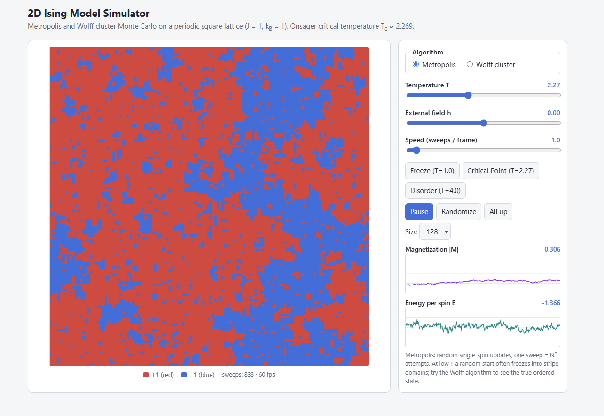
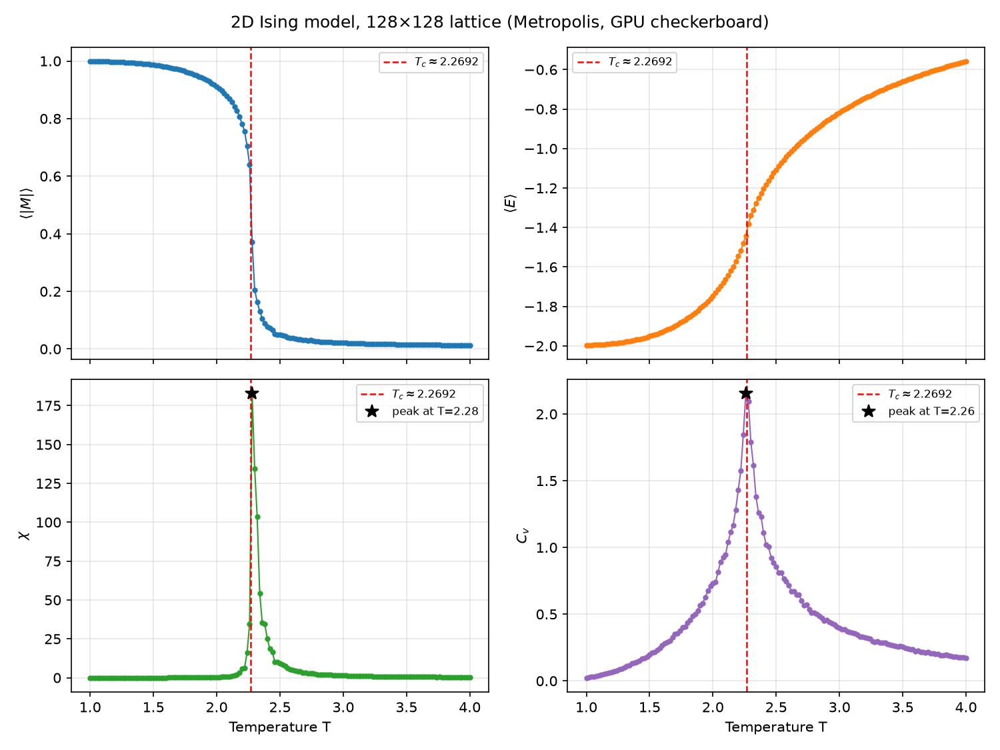
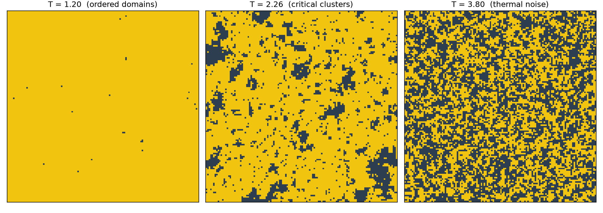
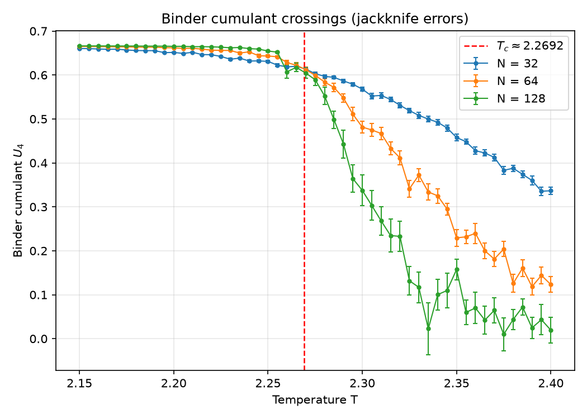
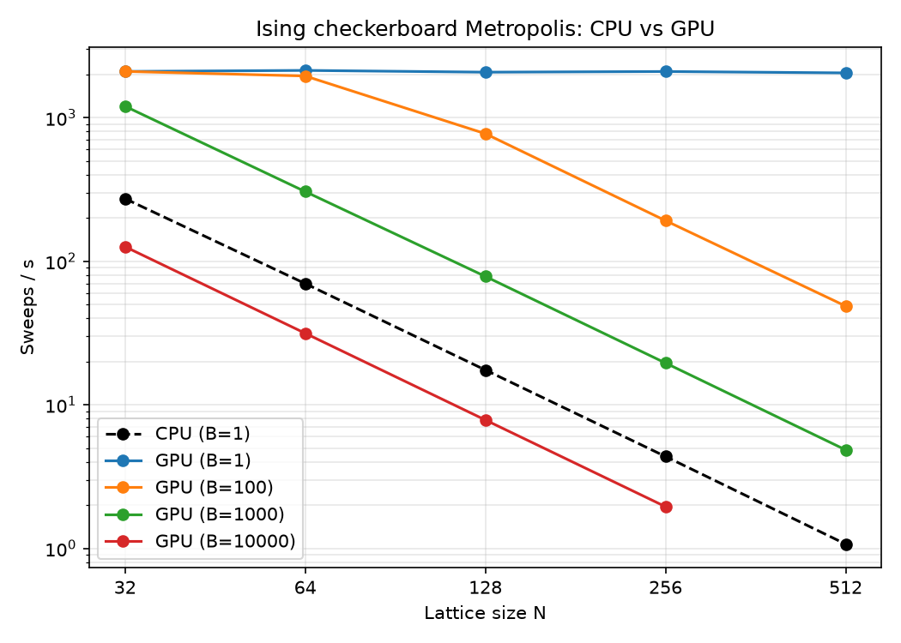
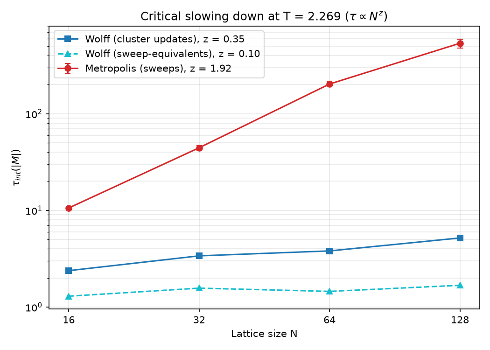

# GPU-Accelerated 2D Ising Model — Monte Carlo with Error Analysis

## Live interactive simulation

<p align="center">
  <a href="https://debanjansaha-git.github.io/isling_model_mcmc/">
    
  </a>
</p>

<p align="center">
  <a href="https://debanjansaha-git.github.io/isling_model_mcmc/"><b>▶ Launch the live simulator</b></a>
</p>

## Executive summary

Metropolis Markov chain Monte Carlo for the 2D Ising model on an NVIDIA RTX 2060 Super.
A checkerboard (Red/Black) decomposition updates half the lattice in parallel with
PyTorch tensor operations, running hundreds to thousands of independent lattices, each
at its own temperature, in one batch. The study goes beyond a phase-transition sweep:
Binder cumulants locate T_c from finite-size crossings, integrated autocorrelation times
quantify critical slowing down, and blocked-jackknife resampling gives error bars on the
non-linear observables χ, C_v and U₄. A sequential CPU implementation serves as the
correctness reference and the performance baseline.

## Key results at a glance

**Throughput** (pure-Python single-spin CPU baseline vs GPU):

| | CPU baseline | GPU checkerboard |
|---|---|---|
| Spin updates / s | ≈ 3.3e+05 | up to ≈ 1.3e+09 |

| Workload | GPU speedup |
|---|---|
| Raw engine, large batches | 4,472–4,627× |
| Full production run (13,000 sweeps × 151 lattices, with per-sweep measurement) | ≈ 2,862× |

The baseline is unoptimized Python; the speedup is not a comparison with tuned CPU code.
CPU times are extrapolated from short runs.

**Physics** (N = 128 sweep, T step 0.02; FSS, N ∈ {32, 64, 128}):

| Observable | Estimate | Exact (Onsager) |
|---|---|---|
| χ peak position | T = 2.28 | T_c = 2.2692 |
| C_v peak position | T = 2.26 | T_c = 2.2692 |
| Binder-cumulant crossings | N=32/64: 2.268, N=64/128: 2.257 | T_c = 2.2692 |
| Autocorrelation exponent z (τ ∝ N^z) | 2.18 | ≈ 2.17 (Metropolis, literature) |
| χ_max N^(−7/4), N = 32/64/128 | 0.048 / 0.050 / 0.050 | constant (scaling) |

Critical slowing down: τ_int(|M|) at T = 2.27 grows from 39
to 802 sweeps between N = 32 and N = 128
(scan maximum: 53 → 2,380).

**Metropolis vs Wolff** — integrated autocorrelation time of |M| at T = 2.269 (Wolff converted to sweep-equivalents; one update costs ⟨|C|⟩/N² sweeps):

| N | Metropolis τ_int (sweeps) | Wolff τ_int (updates) | Wolff τ_int (sweep-equiv.) |
|---|---|---|---|
| 16 | 11 | 2.38 | 1.29 |
| 32 | 44 | 3.39 | 1.57 |
| 64 | 203 | 3.81 | 1.45 |
| 128 | 536 | 5.19 | 1.68 |

Fitted τ ∝ N^z: Metropolis z = 1.92, Wolff z = 0.35 (per update). Single-spin Metropolis slows down near T_c; cluster updates largely remove the effect.

**Parallel tempering** (151 GPU replicas, T ∈ [1, 4], random starts): ⟨|M|⟩ at T = 1 is 0.9993, while 0% of plain Metropolis chains from random starts stay below |M| = 0.9 at this lattice size (stripe traps are size- and seed-dependent).

## Visualizations












## Physics & methodology

**Hamiltonian.** H(σ) = −J Σ⟨i,j⟩ σᵢσⱼ − h Σᵢ σᵢ, σᵢ ∈ {−1, +1}, J = 1, h = 0, k_B = 1,
periodic boundaries. Onsager: T_c = 2J / ln(1 + √2) ≈ 2.269185.

**Observables** (per spin, M = Σσ / N²): χ = (N²/T)(⟨M²⟩ − ⟨|M|⟩²),
C_v = (N²/T²)(⟨E²⟩ − ⟨E⟩²), Binder cumulant U₄ = 1 − ⟨M⁴⟩ / (3⟨M²⟩²)
(→ 2/3 ordered, → 0 for Gaussian fluctuations).

**Checkerboard decomposition.** Sites with (i + j) mod 2 = 0 (Red) have only Black
neighbors, so all Red spins can be updated simultaneously without violating detailed
balance; then all Black spins are updated using the new Red values. A flip is accepted
with probability min(1, e^(−ΔE/T)), ΔE = 2σ(J Σ_nn σ + h); neighbor sums use `torch.roll`.
Each lattice carries its own temperature in a (B, 1, 1) tensor. Spins are int8.

**Wolff cluster algorithm.** Pick a random seed spin; each aligned neighbor of a cluster
spin joins with probability P_add = 1 − exp(−2J/T) (stack-based DFS); flip the whole
cluster with probability 1. This satisfies detailed balance at h = 0 and avoids
critical slowing down. For h ≠ 0 the flip is additionally accepted with
min(1, exp(−2hs|C|/T)).

**Parallel tempering.** Replicas at ascending temperatures T₁ < … < T_R each run
checkerboard sweeps; adjacent configurations are exchanged with probability
min(1, exp((1/T_i − 1/T_{i+1})(E_i − E_{i+1}))), letting configurations trapped in
frozen domains diffuse to high T and re-order.

**Autocorrelation (Sokal window).** C(t) is the normalized autocovariance (FFT). The
integrated time is τ_int(W) = ½ + Σ_{t=1}^{W} C(t), with the window W chosen as the
smallest W satisfying W ≥ 6 τ_int(W). The variance of a sample mean is 2τ_int σ² / n.

**Blocked jackknife.** Split the series into n blocks, compute the statistic θ₍ᵢ₎ with
block i removed. Bias-corrected estimate θ̂ = nθ − (n−1)θ̄₍·₎, error
σ² = (n−1)/n Σᵢ (θ₍ᵢ₎ − θ̄₍·₎)². Blocks longer than τ_int make the error account for
correlations; this works for non-linear statistics such as χ, C_v and U₄.

## Quickstart

Requires Python ≥ 3.11, [uv](https://docs.astral.sh/uv/), and an NVIDIA GPU with CUDA 12.1
drivers (the CPU baseline runs without a GPU).

```bash
uv sync                                    # install dependencies (CUDA 12.1 torch wheel)
uv run pytest                              # full test suite
uv run python -m src.cpu_ising             # CPU demo
uv run python -m src.gpu_ising --batch 10000 --lattice 128   # GPU throughput
uv run python -m src.benchmark             # CPU vs GPU benchmark -> BENCHMARK_REPORT.md
uv run python -m src.simulate              # N=128 sweep -> data/ising_sweep_N128.h5
uv run python -m src.fss                   # FSS dataset -> data/fss_analysis.h5 (~5 min)
uv run python -m src.visualize             # sweep figures
uv run python -m src.visualize_fss         # Binder + collapse figures
uv run python -m src.wolff_ising           # Wolff cluster demo
uv run python -m src.compare_algorithms    # Metropolis vs Wolff tau_int -> docs/images/critical_slowing_down.png
uv run python -m src.parallel_tempering    # replica exchange demo -> data/pt_demo.json
uv run python -m src.report                # regenerate SIMULATION_REPORT.md and README.md
```

`data/*.h5` files are git-ignored; regenerate them with the commands above.

## Project layout

| Path | Purpose |
|---|---|
| `src/cpu_ising.py` | Sequential single-spin Metropolis baseline |
| `src/gpu_ising.py` | Batched checkerboard engine (PyTorch CUDA) |
| `src/simulate.py` | Production temperature sweep |
| `src/wolff_ising.py` | Wolff single-cluster algorithm (NumPy) |
| `src/parallel_tempering.py` | GPU replica-exchange MCMC |
| `src/compare_algorithms.py` | Metropolis vs Wolff autocorrelation study |
| `docs/index.html` | Interactive browser simulator (GitHub Pages) |
| `src/stats.py` | Autocorrelation and jackknife |
| `src/fss.py` | Binder cumulant and finite-size-scaling runs |
| `src/data_io.py` | HDF5 read/write |
| `src/visualize.py`, `src/visualize_fss.py` | Figures |
| `src/benchmark.py`, `src/report.py` | Benchmark and report generation |

Full details, tables and caveats: [SIMULATION_REPORT.md](SIMULATION_REPORT.md),
[BENCHMARK_REPORT.md](BENCHMARK_REPORT.md).
