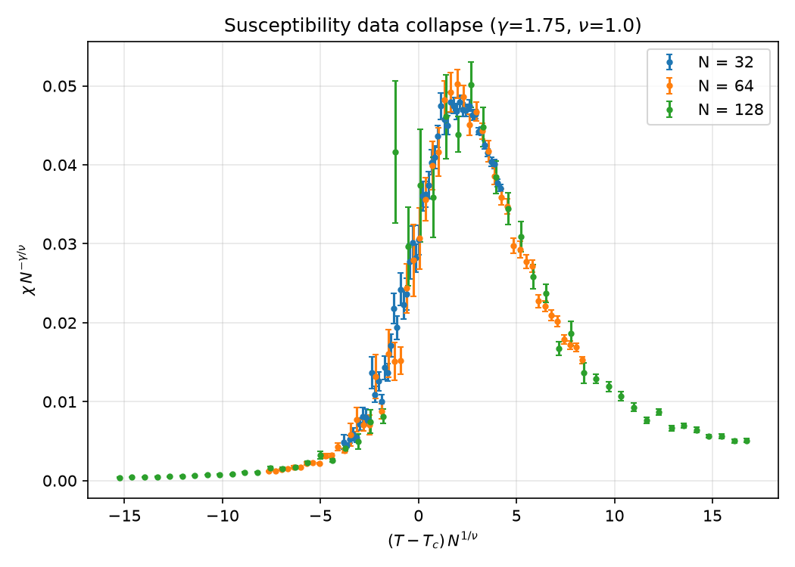

# 2D Ising Model — GPU Checkerboard MCMC: Simulation Report

## Setup

- Square lattice, periodic boundaries, J = 1, h = 0, k_B = 1; Metropolis dynamics with Red/Black checkerboard decomposition (GPU) or sequential single-spin (CPU)
- Production sweep: 128×128, 151 temperatures T ∈ [1.00, 4.00], step 0.02, all chains in one GPU batch; 3,000 thermalization + 10,000 measurement sweeps, observables sampled every sweep
- Initial state: all +1 for T < T_c, random for T ≥ T_c (a random start at low T freezes into striped domains and never reaches the ordered equilibrium)
- Seed 0; GPU: NVIDIA GeForce RTX 2060 SUPER

## Physical results (N=128 temperature sweep)

| Quantity | Estimated T_peak | Onsager T_c | Offset |
|---|---|---|---|
| Susceptibility χ | 2.28 | 2.2692 | +0.011 |
| Specific heat C_v | 2.26 | 2.2692 | -0.009 |

Peak positions are grid maxima (resolution 0.02) from a single run. Peak heights: χ_max = 182.7, C_v,max = 2.15. Finite-size effects shift pseudo-critical points slightly from the infinite-system T_c and autocorrelation times near T_c are long (see below), so offsets of a grid step or two are expected.

| T | ⟨\|M\|⟩ | ⟨E⟩ |
|---|---|---|
| 1.2 | 0.9970 | -1.9886 |
| 2.26 | 0.6403 | -1.4433 |
| 3.8 | 0.0137 | -0.5938 |

## Finite-size scaling and error analysis

Dataset: N ∈ {32, 64, 128}, T ∈ [2.150, 2.400] in steps of 0.005 (51 temperatures), 10,000 thermalization + 100,000 measurement sweeps per lattice, observables sampled after every sweep. Errors are blocked-jackknife with 50 blocks of 2,000 sweeps.

### Binder cumulants U₄

U₄ = 1 − ⟨M⁴⟩ / (3⟨M²⟩²) tends to 2/3 in the ordered phase and to 0 for Gaussian (disordered) fluctuations. Curves for different N intersect near T_c because U₄ is a universal function of (T − T_c)N^{1/ν} up to corrections to scaling.

| Pair | Crossing T | Offset from Onsager T_c |
|---|---|---|
| N=32 / N=64 | 2.2684 | -0.0008 |
| N=64 / N=128 | 2.2567 | -0.0125 |

Onsager T_c = 2.2692. Both crossings lie at or slightly below T_c, spanning 2.257–2.268. The larger-N pair is noisier: near T_c the N=128 chains contain only a few dozen independent samples (see below), and the crossing is a linear interpolation between 0.005-spaced points whose U₄ error bars overlap. Scatter of this size (≈ 0.01 in T) is therefore expected and no systematic shift is claimed.

### Critical slowing down

Integrated autocorrelation time τ_int of |M| (Sokal automatic window, W ≥ 6 τ_int(W)), in sweeps:

| N | τ_int at T=2.27 | max over T scan (at T) |
|---|---|---|
| 32 | 39 | 53 (T=2.195) |
| 64 | 173 | 299 (T=2.265) |
| 128 | 802 | 2,380 (T=2.260) |

The maximum grows from 53 sweeps (N=32) to 2,380 sweeps (N=128). Fitting τ ∝ N^z gives z = 2.18 using τ at T=2.27 (literature value for single-spin Metropolis ≈ 2.17) and z = 2.75 using the scan maximum. The maximum is a noisy statistic (it picks the largest of 51 estimates at each N), so the fixed-temperature fit is the better estimate of z.

Why local updates degrade: single-spin Metropolis moves one spin at a time, so the correlated clusters of size ξ ~ N that appear at T_c relax only by diffusing their boundaries. The relaxation time therefore scales as ξ^z with z ≈ 2.17, i.e. a 4.5× cost for each doubling of N, on top of the 4× cost of the larger lattice. Cluster algorithms (Wolff, Swendsen–Wang) have z ≈ 0.25 and would remove most of this penalty; they are not implemented here.

### Statistical errors (blocked jackknife)

Values at T=2.27 (nearest grid point to T_c), mean ± jackknife error:

| N | U₄ | χ | C_v | n_eff ≈ meas / (2 τ_int) |
|---|---|---|---|---|
| 32 | 0.6135 ± 0.0031 | 13.1 ± 0.8 | 1.810 ± 0.030 | 1288 |
| 64 | 0.6123 ± 0.0063 | 44.4 ± 5.6 | 2.146 ± 0.057 | 288 |
| 128 | 0.6044 ± 0.0122 | 182.0 ± 34.7 | 2.603 ± 0.108 | 62 |

Errors grow with N at fixed sweep count because τ_int grows faster than the number of samples. Caveat: the jackknife block length is 2,000 sweeps, which exceeds τ_int at T_c for all sizes (N=128: 802) but is shorter than the N=128 scan maximum (2,380); error bars for N=128 in the immediate vicinity of the τ_int peak may be underestimated.

### Universal data collapse

Rescaling χ → χ N^(−γ/ν) and T → (T − T_c) N^(1/ν) with the exact 2D Ising exponents γ = 1.75, ν = 1.0 and the exact T_c collapses all sizes onto one curve:

| N | χ_max N^(−γ/ν) | T at χ_max |
|---|---|---|
| 32 | 0.0479 | 2.335 |
| 64 | 0.0502 | 2.300 |
| 128 | 0.0502 | 2.290 |

The scaled peak height is constant to within a few percent across sizes (N=32 is slightly lower, as expected from corrections to scaling). The collapse is a visual and peak-height check, not a fitted exponent estimate.

## Hardware & execution summary

Hardware: NVIDIA GeForce RTX 2060 SUPER (8 GB, compute capability 7.5), torch with CUDA 12.1.

| Metric | Value |
|---|---|
| Production sweep: sweeps × lattices | 13,000 × 151 |
| Total spin updates | 3.216e+10 |
| GPU wall time (incl. per-sweep measurements) | 33.8 s |
| Throughput during production run | 9.512e+08 spin-updates/s |
| Peak raw engine throughput (benchmark, large batch) | 1.29e+09 spin-updates/s |
| CPU baseline, one 128×128 sweep (measured) | 49 ms |
| CPU estimate for the production workload (extrapolated) | 26.9 h |
| Speedup on the production workload | ≈ 2,869× |
| Speedup, raw engine throughput (best-case batches) | 4,472–4,627× |

The production run is slower than the raw engine rate because it measures M and E after every sweep (extra kernels per sweep). Speedups compare against the pure-Python CPU baseline and are extrapolated from short CPU timings; they do not compare against an optimized (e.g. C/numba, multispin-coded) CPU implementation.

### VRAM usage (peak torch allocation, one sweep)

| Workload | N | B | int8 lattices | Peak VRAM |
|---|---|---|---|---|
| FSS run (one size) | 128 | 51 | 0.8 MiB | 14 MiB |
| Production sweep | 128 | 151 | 2.4 MiB | 43 MiB |
| Large batch | 512 | 1,000 | 250.0 MiB | 795 MiB |
| Max batch (CLI default) | 128 | 10,000 | 156.2 MiB | 700 MiB |

Float32 temporaries (random numbers, ΔE, Boltzmann factors) are built per chunk of at most 2²⁵ spins, so peak VRAM stays well under the 1 GiB budget even for the 10,000 × 128² batch. Memory traffic in bytes/s was not profiled.

## Benchmark comparison: CPU single-spin vs GPU checkerboard

From `BENCHMARK_REPORT.md` (CPU entries marked * are extrapolated; see that file for the full N × B throughput grid and `benchmark_results.png`).

### CPU vs GPU: 1000 sweeps, single lattice (B=1)

| N | CPU time | GPU time | Speedup | CPU flips/s | GPU flips/s |
|---|---|---|---|---|---|
| 32 | 3.67 s * | 0.48 s | 7.6x | 2.79e+05 | 2.12e+06 |
| 64 | 14.31 s * | 0.48 s | 29.9x | 2.86e+05 | 8.55e+06 |
| 128 | 57.24 s * | 0.48 s | 119.7x | 2.86e+05 | 3.43e+07 |
| 256 | 229.13 s * | 0.49 s | 472.0x | 2.86e+05 | 1.35e+08 |
| 512 | 0.26 h * | 0.49 s | 1,902.5x | 2.81e+05 | 5.34e+08 |

\* extrapolated from a timed run of fewer than 1000 sweeps.

### CPU vs GPU: best-case throughput (largest feasible batch)

| N | Best B | GPU flips/s | CPU flips/s | Speedup |
|---|---|---|---|---|
| 32 | 10000 | 1.29e+09 | 2.79e+05 | 4,627x |
| 64 | 10000 | 1.29e+09 | 2.86e+05 | 4,507x |
| 128 | 10000 | 1.28e+09 | 2.86e+05 | 4,486x |
| 256 | 10000 | 1.28e+09 | 2.86e+05 | 4,472x |
| 512 | 1000 | 1.27e+09 | 2.81e+05 | 4,530x |

## Limitations

- Single seed per dataset; peak locations are grid maxima without error bars.
- Local updates suffer critical slowing down; N=128 near T_c has few independent samples and the jackknife may be optimistic there (see above).
- The data collapse uses the exact exponents rather than fitting them.
- χ is defined with ⟨|M|⟩² (the standard finite-size convention for h = 0).
